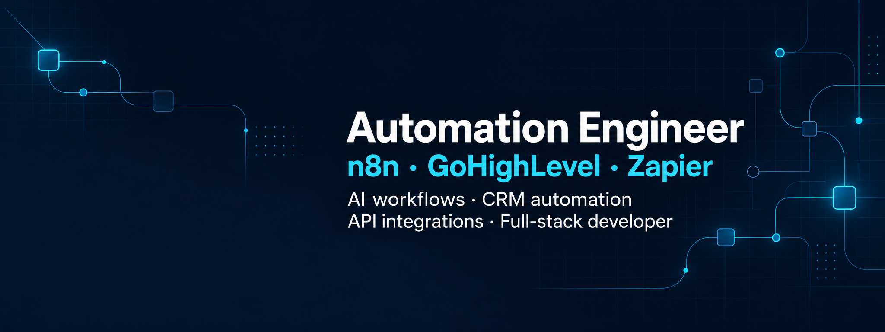

# Tafara Rugara

### Automation Engineer · n8n · GoHighLevel · Zapier
**AI workflows · CRM automation · API integrations · Full-stack developer**

Harare, Zimbabwe / Johannesburg, South Africa · UTC+2 · Open to remote Automation Engineer roles and contracts

[Portfolio](https://tafara.netlify.app) ·  · [LinkedIn](https://www.linkedin.com/in/tafara-rugara-0627b819b/) · [Email](mailto:tfrsuperfx@gmail.com)

---

I design, build and maintain the automation behind business operations: **CRM lifecycle workflows, API integrations, AI agents and LLM pipelines**, with the data checks, error handling and documentation that keep them running. I work in **n8n, GoHighLevel and Zapier**, and build the full-stack apps around them in **TypeScript, React, Next.js and Supabase**, with **Python and Docker** when a workflow needs its own service.

## Currently

**Automation Engineer at Clientharvest.io** (April 2026 – present, remote). GoHighLevel CRM architecture, pipelines, funnels and lifecycle automation for agency clients.

**Full-Stack & Systems Engineer at Mero Tech** (December 2025 – present). Paid client systems (Trevis, RunProduce) and my own products (Munda, Ops Engine, Synapse, IATS).

## Work that shows how I think

| Work | Problem and implementation | Evidence |
| :--- | :--- | :--- |
| **Munda** (tech lead) | Offline-first double-entry ledger for farm inputs (seed, fertiliser, chemicals, diesel). React + TypeScript PWA (TanStack Query, Tailwind) with a Dexie offline queue and idempotent sync; Supabase Postgres does all arithmetic in PL/pgSQL with RLS, Auth and a pg_cron self-check; Ask Munda AI assistant in a Deno Edge Function on Groq with read-only tools and an eval harness. **2,000+ tests**. | [Live demo](https://munda-mvp.netlify.app/) |
| **RunProduce** (client, prelaunch) | Broiler operations and cashflow planner: daily flock data into harvest timing, gate-vs-bulk sales split, next-batch sizing and a projected cash calendar. Next.js + Supabase around a pure TypeScript engine (bigint cents, integer grams, typed missing-input results). | Private client repo |
| **Patient-retention automation** | A router across Practice Better, GoHighLevel and Zapier handled one patient type and silently dropped the rest. Repaired **7 triggers** and shipped **3 lifecycle workflows**, then delivered the full system: **9 GHL workflows and 7 live Zaps**. | Client work at Clientharvest.io; detailed in my [CV](https://tafara.netlify.app/documents/tafara-rugara-automation-engineer-cv.pdf) |
| **Delivery health intelligence** | **27-node n8n pilot** that normalizes ClickUp tasks, validates Gemini output, writes updates back and routes aggregated alerts or manual review. Shortlisted in a client evaluation. | [Workflow export and docs](https://github.com/98Devops/AI-Powered-Delivery-Health-Operations-Intelligence-System) · [Walkthrough](https://www.youtube.com/watch?v=c8ETK5kOh08) |
| **Trevis** (paid client, live) | Replaced **4 spreadsheets** with one live system for **130+ tenants across 4 properties**: a ledger-derived coverage engine marks each tenant paid-up, expiring or overdue; nightly integrity audit, daily owner report, about **190 Vitest tests**. Delivered and paid in full. | [Source and notes](https://github.com/98Devops/trevis-app/tree/main/trevis-production) · [Live app](https://trevis.netlify.app/) |
| **IATS** | Multi-tenant ICT asset tracking SaaS for schools, NGOs and businesses: React 18, TypeScript, Zod, TanStack Query; role-based access in PL/pgSQL RLS, append-only chain-of-custody history, QR scan workflows. | Private repo |
| **Ops Engine** (my B2B client-acquisition system) | Self-hosted on an Ubuntu homelab: n8n workflows ingest leads and jobs from Gmail and Telegram, score them against a rubric, draft proposals and emails with Claude, Groq and Gemini, and run follow-ups. Supabase schema with RLS and metric views feeds a React dashboard of revenue, response rate and follow-up status; Python host shim for scraping and agent calls over Tailscale. | Private repo |
| **Synapse** (AI engineering) | Voice-first knowledge app on Next.js 15: transcription, Gemini entity extraction and classification, a knowledge graph plus Qdrant embeddings, and a LangChain agent that answers by combining graph and vector retrieval (RAG), with text-to-speech playback. | [Repository](https://github.com/98Devops/synapse) |
| **Voice-to-insight pipeline** | n8n flow: Google Drive trigger, Whisper transcription, Gemini intent extraction into schema-validated JSON, auto-filed tasks in Obsidian. | [Demo](https://www.youtube.com/watch?v=b5xatvQ6TQQ) |
| **Voice-to-Vector** | Voice notes stored as vector embeddings with semantic search; rebuilt serverless on Netlify Functions and Qdrant Cloud. | [Repository](https://github.com/98Devops/Voice-to-vector) |
| **AI tax agent (prototype)** | Telegram agent for Botswana SMEs: RAG over BURS regulations, calculator tool and session memory in n8n. | [Demo](https://www.youtube.com/watch?v=IEMl8c1U_4s) |

## Technical stack

| Area | Tools and techniques |
| :--- | :--- |
| **Workflow automation** | n8n, Zapier, GoHighLevel (GHL), Practice Better, ClickUp, Google Workspace, WhatsApp, Telegram; triggers, conditional routing, webhooks, scheduled jobs |
| **CRM and marketing automation** | CRM architecture, pipelines, custom fields, tags, funnels, landing pages, email campaigns, lifecycle and reactivation workflows |
| **AI and LLM integration** | AI agents, prompt engineering, structured output and JSON schema validation, RAG, Qdrant, Gemini, Whisper, OpenRouter, LangChain, CrewAI |
| **Full-stack development** | TypeScript, JavaScript, React, Next.js, Vite, Node.js, React Router, TanStack Query, Zod, Tailwind CSS, PWAs, offline-first sync (Dexie) |
| **Backend and data** | Supabase (PostgreSQL, Row-Level Security, Auth, Storage, Edge Functions, pg_cron), PL/pgSQL, Python, Flask, FastAPI |
| **APIs and integration** | REST APIs, webhooks, OAuth2, JSON transformation, data mapping |
| **DevOps and reliability** | Docker, Docker Compose, Linux (Ubuntu Server homelab), Tailscale, AWS, DigitalOcean, Netlify, GitHub Actions; error handling, retry logic, monitoring, alert aggregation, Vitest, Jest, documentation |

## How I deliver automation

- **Map the process.** Inputs, owners, branching rules, expected outputs and failure paths before building.
- **Make data predictable.** Normalize records and validate AI output before it reaches downstream actions.
- **Test the whole workflow.** Triggers, forms, payments, domains, routing and workflow exits before handover.
- **Keep operations visible.** Integrity checks, execution monitoring, consolidated alerts and manual-review paths.
- **Leave a maintainable system.** Architecture, configuration, troubleshooting and handover notes.

## Experience

| Period | Role |
| :--- | :--- |
| **April 2026 – Present** | Automation Engineer · **Clientharvest.io** · Remote, contract |
| **December 2025 – Present** | Full-Stack & Systems Engineer · **Mero Tech** · Freelance, Harare |
| **May 2025 – October 2025** | DevOps Engineer · **Excellessence (YourEKA Services)** · Harare, hybrid |

**Certification:** AWS Certified Cloud Practitioner (2024) · AWS Solutions Architect – Associate in progress.

